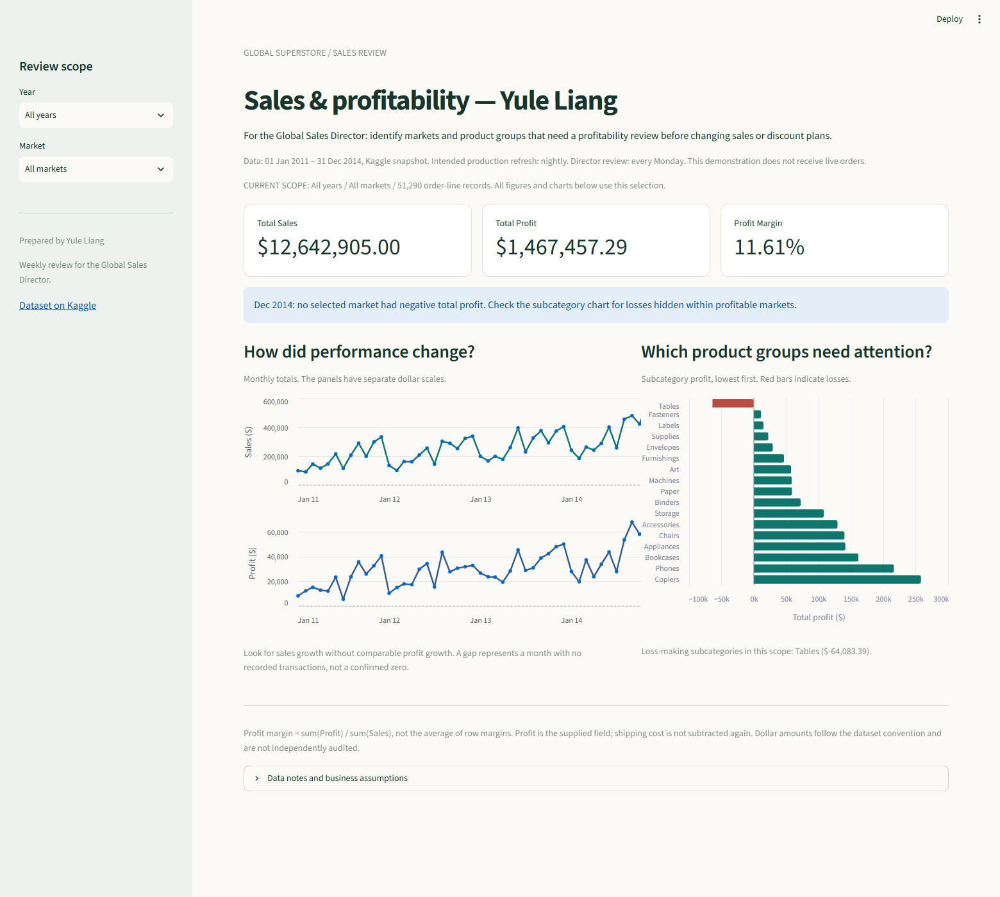

# Global Superstore Sales & Profitability

**Author / team: Yule Liang**  
BANA409, Assignment 4, Part 1

A Streamlit dashboard for the **Global Sales Director** to identify markets and
product groups that need a profitability review before changing sales and discount
plans. The dashboard uses a historical Kaggle snapshot.



## Step 1 — Dataset and decision-maker

- **Source:** [Global Superstore Dataset, published by Fatih İlhan on Kaggle](https://www.kaggle.com/datasets/fatihilhan/global-superstore-dataset).
- **Source file:** `superstore.csv`, 15,844,267 bytes (about 15.1 MiB), below the exercise's approximate 25 MB limit. The repository packages it as `superstore.csv.gz` (3,196,206 bytes). This is lossless gzip compression, not sampling; decompressing it reproduces the original CSV byte for byte. Pandas reads the compressed file directly.
- **Coverage:** January 1, 2011 through December 31, 2014.
- **Size:** 51,290 rows and 27 original columns, covering 7 markets and 147 countries.
- **Unit of observation:** one product line within an order. There are 25,035 distinct `Order.ID` values; multiple lines of one order must not be mistaken for separate orders.
- **Provenance:** the uploader describes a CSV conversion of the Global Superstore data using R and links to an earlier Kaggle version. The public page does not establish independently verifiable real-company provenance. We treat it as an **educational, fictional retail scenario**, not audited company transactions. [Tableau describes the Superstore sample family as fictitious](https://help.tableau.com/current/guides/get-started-tutorial/en-us/get-started-tutorial-connect.htm); this is context, not proof of the exact lineage of this processed CSV.
- **License:** the Kaggle dataset metadata lists MIT. The source link is retained for attribution; no ownership of the source data is claimed.
- **Preparation:** all original rows and columns are preserved. No sampling, aggregation of the stored source, or imputation was needed. Dates are parsed and aggregates are calculated when the app runs.

The **Global Sales Director** is the single intended decision-maker. Their role
requires comparisons across markets and product groups. Customer service agents and
warehouse staff would need different information, so the page is not designed for them.

## Step 2 — Why this dashboard is needed

### Who uses it and how often?

The director reviews it every Monday before the weekly sales meeting and may revisit
it when a regional team reports unusual performance. In a production system, the
underlying transactions would refresh nightly; viewing frequency and refresh frequency
serve different needs.

### What decision does it support?

The director decides **which markets and product groups need investigation and whether
their sales or discount plans should be reviewed**. Sales volume alone can hide losses.
The dashboard combines sales scale, reported profit, and profit margin, then shows the
time trend and the subcategories contributing to profit or loss.

> If the Global Sales Director sees negative profit in a market's latest complete month,
> they will ask the regional manager to investigate loss-making subcategories and their
> discount terms before approving the next promotion.

A second reason to investigate is sales rising without a corresponding improvement
in profit. Such a pattern prompts a review of product mix, pricing, discounts, and
costs; the charts alone do not prove which factor caused the change.

### How would the work be done without it?

For this scenario, the assumed alternative is a weekly spreadsheet workflow: export
orders, filter the period and market, rebuild pivot tables, calculate margins, and
send screenshots to the director. Repeated manual preparation creates opportunities
for inconsistent filters, averaging percentages incorrectly, and overlooking losses.

There is no measured operating history for this fictional platform. As an explicit
planning assumption, two hours spent preparing each weekly report would consume
104 analyst-hours a year. This is an illustration of recurring work, not a measured
time saving. The monetary risk is allowing unprofitable promotions to continue while
their losses are hidden by sales growth or profitable products elsewhere.

### Why a dashboard rather than an email, report, or alert?

The same user needs to revisit the same questions every week and change the market
or year under review. An email or fixed report cannot support that immediate change
of scope. An alert can identify a threshold breach, but the director still needs
historical and product context to investigate it. A dashboard combines a consistent
set of calculations with interactive comparisons. A production alert would complement it.

## Step 3 — What is shown, what is cut, and why

The executed [`analysis.ipynb`](analysis.ipynb) checks shape, field types, missing
values, duplicates, distributions, time coverage, and relationships among sales,
profit, market, category, and discount.

### Headline metrics

| Metric | Definition within the selected year and market | Decision value |
| --- | --- | --- |
| Total Sales | `sum(Sales)` | Shows business scale; high revenue alone does not establish profitability. |
| Total Profit | `sum(Profit)` | Shows reported profit dollars and the scale of losses. |
| Profit Margin | `sum(Profit) / sum(Sales)` | Shows profit per sales dollar; calculated from totals, not an average of line margins. |

Across the full snapshot, sales are **$12,642,905.00**, reported profit is
**$1,467,457.29**, and profit margin is **11.61%**. The dashboard recalculates all three
after either filter changes. A zero-total-sales scope displays an undefined margin as N/A.

### Two supporting charts

1. **Monthly sales and profit trends**, arranged as two panels in one chart. Their
   separate, labeled dollar scales prevent sales from making profit movement unreadable.
   They show when performance changes and whether profit is keeping pace with sales.
2. **Subcategory profit ranked from lowest to highest**, with negative bars in red.
   This identifies the product groups to investigate. Tooltips include sales and margin,
   so the director can distinguish small contributions from inefficient high-sales groups.

The EDA supports these choices. Furniture produces **$4,110,884** in sales but only
about **6.94%** margin, compared with about **13.99%** for Technology. Tables alone
have **-$64,083.39** reported profit across the snapshot. A total-sales chart would hide
that problem. EMEA's margin is approximately **5.45%**, which also supports a market filter.

### Filters and page order

Only **year** and **market** are exposed. They match the director's review scope and
provide enough detail without adding ten controls. The default is all years and all
markets so the complete snapshot is visible immediately.

The page order follows [`docs/layout.md`](docs/layout.md): title and purpose; historical
period and refresh disclosure; the three metrics; a monthly review message; the trend
and subcategory charts; metric definitions and expandable data notes. The indicators
establish scale first, trends explain timing, and ranked products identify where to act.
The sidebar keeps the filters visible. A raw customer-level table is not needed.

### Two things deliberately not shown

1. **Customer names and individual customer rankings.** Account-level sales actions
   belong with account managers. They do not help the director prioritize a market or
   subcategory profitability review and would add distracting detail.
2. **A country/city map.** Geographic coverage is broad, but geographic area does not
   explain profit. A market selector and ranked profit bars answer the decision more
   directly than a map and avoid implying that large countries are more important.

### Data limitations and safeguards

- **Line grain:** negative profit occurs on 12,544 lines (24.46%), not necessarily on
  12,544 distinct orders. Rows are not counted as orders and negative values are retained.
- **Source quality:** there are no missing cells, fully duplicated rows, or repeated
  `Row.ID` values in this file. That does not establish that the business data are accurate.
- **Precision:** all supplied Sales values are whole numbers, including one zero-sales
  line with a -$1.11 profit. We retain this record in totals and do not reconstruct cents.
- **Profit definition:** Profit is the supplied measure, not a claim about audited net
  income. We do not subtract Shipping.Cost again because its relationship to Profit is
  not fully documented. Dollar labels follow the dataset convention; currency conversion
  and accounting definitions have not been independently verified.
- **Time coverage:** all 48 months are represented globally. A selected market can have
  a gap. Missing months stay missing in the trend, rather than being presented as a
  confirmed zero. The snapshot dates appear prominently so historical figures cannot
  be mistaken for live sales.
- **Outliers and explanations:** large positive or negative transactions are retained;
  they can be genuine high-value sales or losses. Discount groups are compared in EDA,
  but an association between discounts and losses does not establish causality.
- **Seasonality:** a month-to-month change can reflect a seasonal pattern. The director
  should compare the same part of prior years before attributing a change to a promotion.

## Step 4 — Refresh frequency and action

| Item | Proposed production policy | Reason |
| --- | --- | --- |
| Data refresh | Nightly after the transaction system closes its daily batch | Orders change daily; weekly planning does not require second-by-second refresh. |
| Director review | Every Monday before the sales meeting | Fits the recurring sales and promotion review. |
| Metric tracked | Monthly reported profit for each market | A sales increase should not conceal an unprofitable market. |
| Action trigger | A market's total profit is below $0 for the latest complete month | Ask the regional team to investigate the losing product groups and discount terms. |

The $0 trigger is a **proposed management rule**, not a historical corporate policy
or a threshold learned from this data. The app evaluates it for the latest complete
month available in the selected historical scope and labels the month explicitly.
When the condition is met, it shows the market and loss amount. A positive market
total is not an all-clear: the subcategory chart can still reveal losses within it.

In production, the alert check could run after each nightly load, using the most
recent completed month's result. The director's weekly review then adds context.
Nightly refresh also supports later improvements such as a month-to-date comparison,
but such a comparison would need an agreed seasonal baseline and is not implemented here.

One day of stale data could omit corrections or newly posted transactions and mislead
a follow-up review. A week of stale data could cause an entire sales meeting to use the
previous position, delaying a review of loss-making promotions. Real-time integration
would add cost without changing the timing of this director's routine decisions.

The deployed demonstration reads the committed CSV. **No automatic production data
feed is connected.** The page states the historical data period, intended nightly
refresh, and weekly review frequency. Updating the app's cache does not create new orders.

## Step 5 — Run, verify, and deploy

The project was initialized with `uv init` for Python 3.14. The complete CSV is included in lossless gzip form
so the app needs neither Kaggle credentials nor an external data download at runtime.

```bash
uv sync
uv run streamlit run app.py
```

Open `analysis.ipynb` with the project's `.venv` Python interpreter to inspect the
executed exploration. Run the verification suite with:

```bash
uv run python -m unittest discover -s tests -v
```

The checks cover full-snapshot totals, filter and monthly reconciliation, undefined
zero-sales margins, missing months, successful app rendering, and the actual data sent
to both charts after filters change.

To deploy on **Yule Liang's own Streamlit Community Cloud account**:

1. Connect that account to GitHub and choose repository
   `kousaka1026/superstore-dashboard`.
2. Select branch `main` and entrypoint `app.py`.
3. Under Advanced settings select **Python 3.14**, as required by the course, then deploy.
4. Verify that the public app loads and that changing Year or Market updates all
   three indicators and both charts.
5. Copy the resulting public app URL and the repository URL into the first Markdown
   cell of the final `phone-trade-in.ipynb` submission. No deployment URL is claimed
   before deployment has succeeded.

Repository: [kousaka1026/superstore-dashboard](https://github.com/kousaka1026/superstore-dashboard).

## Sources

- [Course exercise and required design questions](https://bana409.harrywang.me/docs/lectures/data-app/in-class-group-exercise)
- [Assignment 4 and individual account/submission requirements](https://bana409.harrywang.me/docs/assignments/assignment-4-linear-regression-sgd-and-random-forest)
- [Kaggle data source](https://www.kaggle.com/datasets/fatihilhan/global-superstore-dataset)
- [Kaggle metadata identifying the uploader, conversion, and license](https://www.kaggle.com/api/v1/datasets/view/fatihilhan/global-superstore-dataset)
- [Tableau documentation on the fictional Superstore sample family](https://help.tableau.com/current/guides/get-started-tutorial/en-us/get-started-tutorial-connect.htm)
